# Smart Lamp

Two WiFi lamps, one for me and one for my girlfriend. Tap yours and the other
one lights up, wherever it is.

  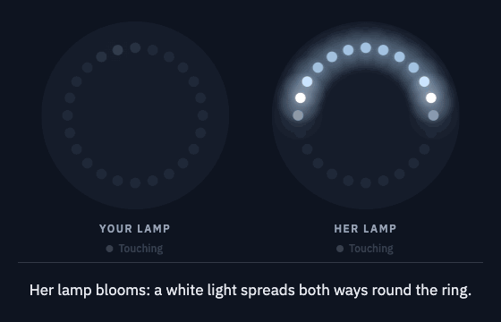

I'm a software engineer, so the code was the easy part. I had never soldered,
never wired a circuit and never done any CAD. I built the whole thing with
[Claude Code](https://claude.com/claude-code), and used it to teach me the
hardware side as I went: what to buy, how to wire it, how to solder it and how
to print the case.

## What it does

There's no app and no buttons, just a touch spot on each lamp.

<table>
  <tr>
    <td width="50%">
      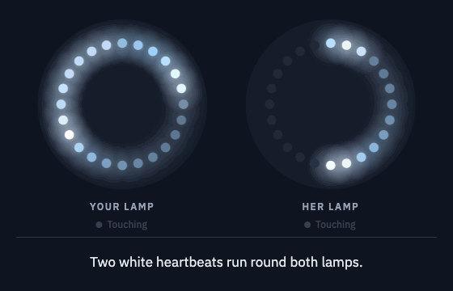 
      <b>Double tap</b> answers her tap. Two heartbeats run round both lamps, so she knows it arrived.
    </td>
    <td width="50%">
      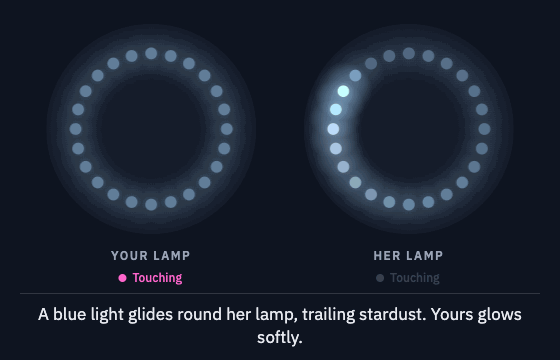 
      <b>Hold</b> means "I'm here". A light circles her lamp for as long as you keep your finger down.
    </td>
  </tr>
  <tr>
    <td>
      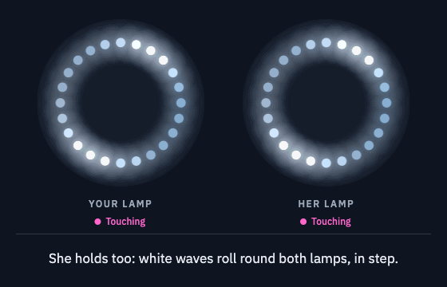 
      <b>Both hold at once</b> and the lamps sync up, rolling the same waves round in step.
    </td>
    <td>
      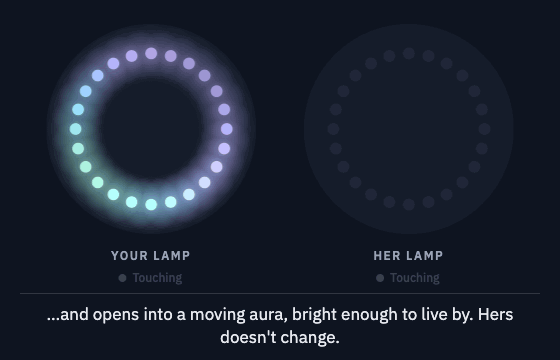 
      <b>Double tap with nothing to answer</b> and your lamp becomes an actual lamp.
    </td>
  </tr>
</table>

### And some secret ones

A few quick taps, or a few taps and then a hold, set off a show on both lamps.
Mash it and hold for a rave.

<table>
  <tr>
    <td align="center">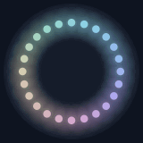 Rainbow bloom 3 taps</td>
    <td align="center">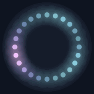 Aurora 4 taps</td>
    <td align="center">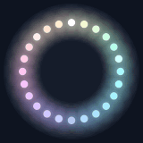 Supernova 5 taps</td>
    <td align="center">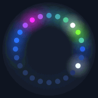 Rave mash, then hold</td>
  </tr>
  <tr>
    <td align="center">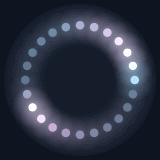 Heartbeat 3 taps, then hold</td>
    <td align="center">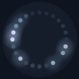 Constellation 4 taps, then hold</td>
    <td align="center">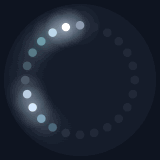 Meteor shower rare: 5 taps, then hold</td>
    <td align="center">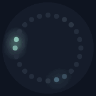 Fireflies rare: 5 taps, then hold</td>
  </tr>
</table>

## Built with AI

**The build guide.** Claude made me an
[interactive build guide](https://claude.ai/artifact/NWUZS2aGTcL2LgVJx6mHmB),
and that's what I actually followed: what to order, a checklist of steps with
the exact command to paste at each one, wiring diagrams, how to solder each
joint, and how to test each stage before starting the next. Its lamp manual
runs a line-for-line JavaScript port of the firmware's animation code, so it
shows exactly what the real lamps do. Every animation on this page was
recorded from it.

  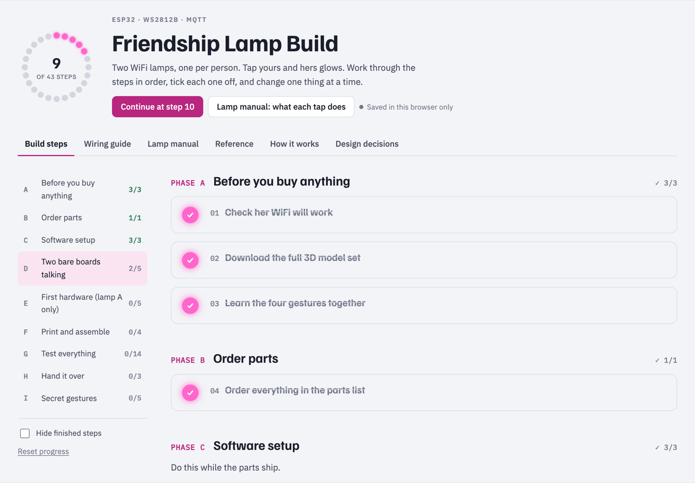

**The firmware.** About 1,850 lines of C++ for the ESP32, written with Claude
Code: [`src/main.cpp`](src/main.cpp).

**Rules for the AI.** [`CLAUDE.md`](CLAUDE.md) is the file Claude reads before
every change: the hard constraints, the designs it mustn't "simplify" away and
the decisions that are settled, so a new session can't quietly undo them.

**The case.** [Linked Lamp](https://github.com/aarushmagic/Linked-Lamp)'s
design, rebuilt in a [CadQuery](https://github.com/CadQuery/cadquery) script
to fit a bigger 24-LED ring, with a name engraved on top.

  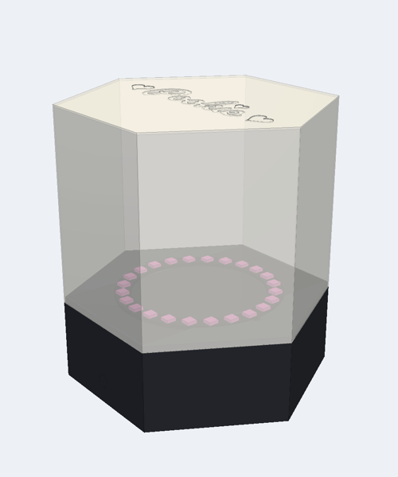
  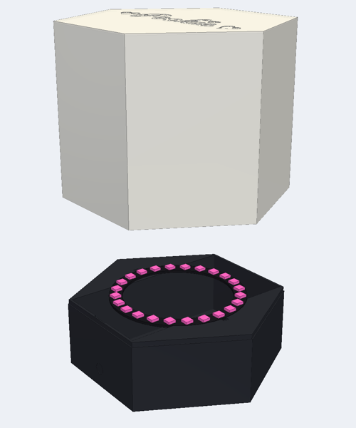
  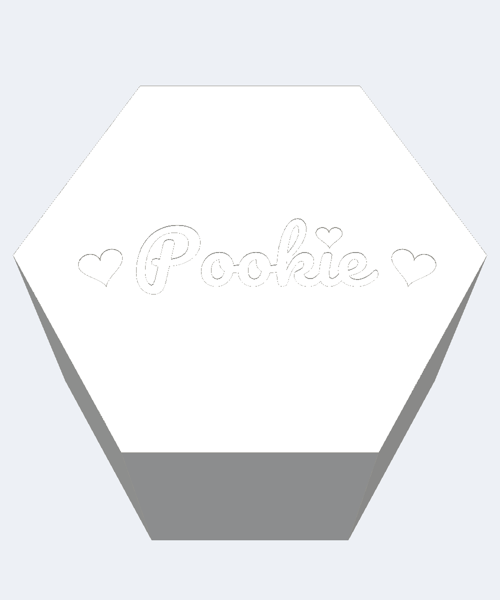

## The hardware

Each lamp is an ESP32 board, a ring of 24 LEDs and a touch sensor, powered over
USB. That's six jumper wires and three solder joints per lamp.

  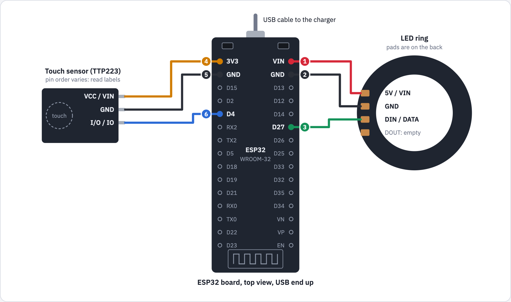

The lamps talk through a free cloud MQTT broker over TLS, so there's no server
of my own to keep running. Both run identical firmware; only the device ID
differs. Taps and holds are sent as one-off events, never stored, so if a
lamp loses WiFi or gets unplugged it comes back dark instead of stuck on. When
you both hold at once, each lamp sees its own finger and the other's hold and
works out on its own that it's a shared hold, with no coordinator.

## More

- [`docs/GUIDE.md`](docs/GUIDE.md): the full written guide. Build steps,
  parts list, troubleshooting, how it works and every design decision.
- [`src/config.example.h`](src/config.example.h): settings template. Copy it
  to `src/config.h` (gitignored) and fill in your broker details.
- [`3d-design/`](3d-design): the CadQuery scripts for the case.

3D model base by [Linked Lamp](https://github.com/aarushmagic/Linked-Lamp).
Script font is [Pacifico](3d-design/fonts/OFL.txt) (SIL Open Font License).
